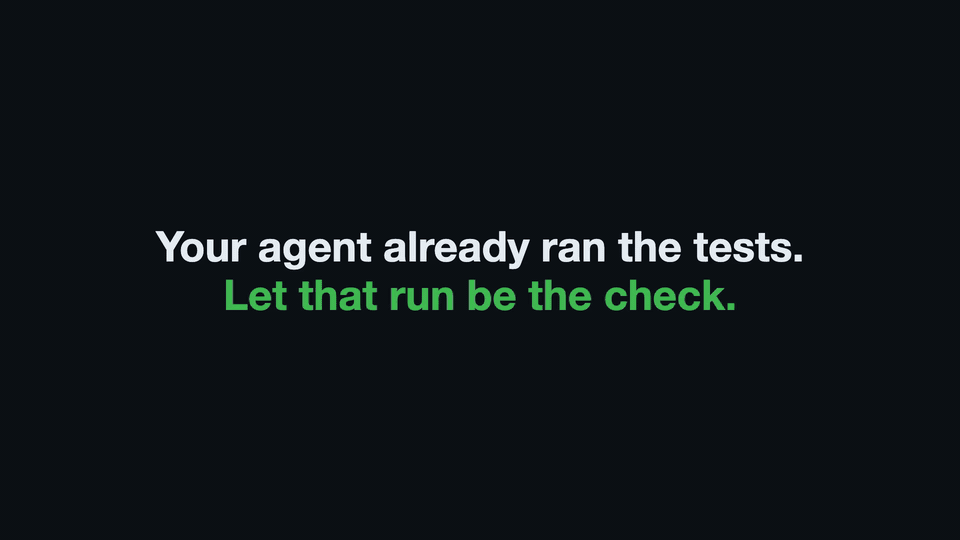

# shipcheck

[](https://github.com/gabrielkoerich/shipcheck/actions/workflows/ci.yml) [](https://github.com/gabrielkoerich/shipcheck/releases/latest) [](https://github.com/gabrielkoerich/homebrew-tap) [](https://crates.io/crates/shipcheck) [](LICENSE) [![shipcheck](https://img.shields.io/github/check-runs/gabrielkoerich/shipcheck/main?nameFilter=shipcheck&label=shipcheck&logo=data:image/svg%2bxml;base64,PHN2ZyB4bWxucz0iaHR0cDovL3d3dy53My5vcmcvMjAwMC9zdmciIHZpZXdCb3g9IjAgMCAxMjAgMTIwIiByb2xlPSJpbWciIGFyaWEtbGFiZWw9InNoaXBjaGVjayI+CiAgPGcgdHJhbnNmb3JtPSJ0cmFuc2xhdGUoMCA4KSI+CiAgICA8cmVjdCB4PSIxMCIgeT0iMjIiIHdpZHRoPSIxMDAiIGhlaWdodD0iNzQiIHJ4PSIxNCIgZmlsbD0iI0Y1QzUxOCIvPgogICAgPHJlY3QgeD0iMTAiIHk9IjIyIiB3aWR0aD0iMTAwIiBoZWlnaHQ9Ijc0IiByeD0iMTQiIGZpbGw9Im5vbmUiIHN0cm9rZT0iIzE2MTgxRCIgc3Ryb2tlLXdpZHRoPSI0Ii8+CiAgICA8cGF0aCBkPSJNMzAgMjJ2NzRNOTAgMjJ2NzQiIHN0cm9rZT0iIzE2MTgxRCIgc3Ryb2tlLXdpZHRoPSIzIiBvcGFjaXR5PSIuMjUiLz4KICAgIDxjaXJjbGUgY3g9IjQ2IiBjeT0iNTIiIHI9IjYiIGZpbGw9IiMxNjE4MUQiLz4KICAgIDxjaXJjbGUgY3g9Ijc0IiBjeT0iNTIiIHI9IjYiIGZpbGw9IiMxNjE4MUQiLz4KICAgIDxwYXRoIGQ9Ik00NCA3MGwxMCA5IDIwLTE4IiBmaWxsPSJub25lIiBzdHJva2U9IiMxRjlENTUiIHN0cm9rZS13aWR0aD0iNiIgc3Ryb2tlLWxpbmVjYXA9InJvdW5kIiBzdHJva2UtbGluZWpvaW49InJvdW5kIi8+CiAgICA8cGF0aCBkPSJNMzggMjJsOC0xNGgyOGw4IDE0IiBmaWxsPSIjRjVDNTE4IiBzdHJva2U9IiMxNjE4MUQiIHN0cm9rZS13aWR0aD0iNCIgc3Ryb2tlLWxpbmVqb2luPSJyb3VuZCIvPgogIDwvZz4KPC9zdmc+Cg==)](https://github.com/gabrielkoerich/shipcheck/commits/main)

Your agent already ran the tests. shipcheck runs your repository's checks on your machine, keeps the result for that exact git tree, and posts the required checks, one per job, from its GitHub App. A PR whose tree was already tested gets its checks in under a second.



It has two modes:

- Host mode, which `shipcheck init` writes when it finds your checks, runs the commands of your workflow jobs, such as `cargo test` or `npm test`, natively in an OS sandbox, with no Docker. On a machine set up like production, with the same tools, dependencies, OS and system libraries, that tests the code where it will run.
- act mode, the default without `runner`, runs your GitHub Actions workflows in containers with act, on a running Docker engine. It is the mode closest to GitHub's CI.

A repository without `.github/workflows` runs in host mode: set `runner = "host"` and list its commands under `[host.checks]` in `shipcheck.toml`.

`runner` is the mode of every job, and a `[jobs]` table moves one job to the other mode in the same run, such as a `ci.yml/e2e` job that needs Docker under act beside the host checks.

Measured on an idle Apple silicon Mac against GitHub's hosted runners, same commits: a large Rust app in act took 105 s warm against 115 to 124 s, and a tree already tested answers in under a second. A first run that starts cold can take longer than GitHub: the same app took 238 s against 116 s. [Speed](https://shipcheck.run/docs/speed/) has the settings that make runs fast.

Docs: https://shipcheck.run/docs/.

## Install

With Homebrew, which also installs act, git and the Docker client:

```sh
brew install gabrielkoerich/tap/shipcheck
```

Or with the install script:

```sh
curl -fsSL https://shipcheck.run/install.sh | sh
```

Or with [cargo-binstall](https://github.com/cargo-bins/cargo-binstall), which downloads the same release binary, no Rust needed:

```sh
cargo binstall shipcheck
```

Homebrew, the install script and cargo-binstall install the release binary. On macOS it is signed with a Developer ID and notarized, and its signature stays the same across upgrades.

Or build it from source with cargo, Rust 1.89 or later: from crates.io, from this repository, or from a clone. A build is not signed or notarized. Each build gets a new signature, so macOS asks once per keychain item after it:

```sh
cargo install shipcheck
cargo install --git https://github.com/gabrielkoerich/shipcheck shipcheck
git clone https://github.com/gabrielkoerich/shipcheck && cargo install --path shipcheck
```

| Needs | When | Why |
|---|---|---|
| git | Always | shipcheck reads commits, trees and `main` from your clone |
| An OS sandbox | Host mode | macOS has `sandbox-exec`. On Linux, install bubblewrap |
| A running Docker engine | act mode, also with `engine = "colima"` | act runs each job in a container. Docker Desktop 4.44.3 or later, with runc 1.2.8, 1.3.3 or later. Docker Desktop is recommended. After each merge to `main`, shipcheck's act end-to-end tests run in CI on GitHub's Ubuntu runners with Docker Engine, and this repository's `shipcheck/test` check runs on a colima VM. act jobs have also run with Docker Desktop, OrbStack or colima as the Docker engine, with the limits the install docs list |
| [act](https://github.com/nektos/act) 0.2.86 or later | act mode | Runs the workflows. `brew install act` |
| colima and lima | `engine = "colima"` | Each such job runs in a VM of its own, with Docker inside the VM. `brew install colima` |
| A copy-on-write filesystem | Recommended | APFS on macOS, btrfs or XFS on Linux, so a warm checkout costs no disk. On other filesystems shipcheck falls back to a plain git worktree |

## Set up a repository

1. Install the binary, above.
2. Run `shipcheck init` in a clone of the repository, on `main`. An agent or a script runs `shipcheck init --yes`. Without a terminal and without `--yes`, `init` only prints its plan.
3. Commit the `shipcheck.toml` it writes and merge it to `main`. Here and below, `main` is the remote's default branch. Until then there is nothing to run: `shipcheck run` exits 2, and the hooks and the daemon start nothing.
4. Install the [shipcheck App](https://github.com/apps/shipcheck-run) on the repository. `init` prints this link.

[The quickstart](https://shipcheck.run/docs/quickstart/) says what each step does. Each other clone needs `shipcheck install` once. In a terminal, `init` and `install` sign the machine in when it cannot post yet. A machine with no person at it gets a token from `shipcheck token` instead, set as `SHIPCHECK_TOKEN` ([unattended machines](https://shipcheck.run/docs/install/#unattended-machines)). `shipcheck logout` revokes this machine's shipcheck token, and `shipcheck logout --all` revokes every shipcheck token of your GitHub user. It never touches a GitHub token.

shipcheck then posts one check per job, such as `shipcheck/test`, as Actions does. Those are the checks branch protection requires. A `shipcheck` check beside them sums up the run. shipcheck posts only through the [shipcheck App](https://github.com/apps/shipcheck-run) and the hosted service, with the machine token from `shipcheck login` or `shipcheck token`.

To show the state of `main`'s `shipcheck` check, add this line to a public repository's README, with your owner, repository and default branch. shields.io reads only public repositories:

```markdown
[![shipcheck](https://img.shields.io/github/check-runs/OWNER/REPO/main?nameFilter=shipcheck&label=shipcheck&logo=data:image/svg%2bxml;base64,PHN2ZyB4bWxucz0iaHR0cDovL3d3dy53My5vcmcvMjAwMC9zdmciIHZpZXdCb3g9IjAgMCAxMjAgMTIwIiByb2xlPSJpbWciIGFyaWEtbGFiZWw9InNoaXBjaGVjayI+CiAgPGcgdHJhbnNmb3JtPSJ0cmFuc2xhdGUoMCA4KSI+CiAgICA8cmVjdCB4PSIxMCIgeT0iMjIiIHdpZHRoPSIxMDAiIGhlaWdodD0iNzQiIHJ4PSIxNCIgZmlsbD0iI0Y1QzUxOCIvPgogICAgPHJlY3QgeD0iMTAiIHk9IjIyIiB3aWR0aD0iMTAwIiBoZWlnaHQ9Ijc0IiByeD0iMTQiIGZpbGw9Im5vbmUiIHN0cm9rZT0iIzE2MTgxRCIgc3Ryb2tlLXdpZHRoPSI0Ii8+CiAgICA8cGF0aCBkPSJNMzAgMjJ2NzRNOTAgMjJ2NzQiIHN0cm9rZT0iIzE2MTgxRCIgc3Ryb2tlLXdpZHRoPSIzIiBvcGFjaXR5PSIuMjUiLz4KICAgIDxjaXJjbGUgY3g9IjQ2IiBjeT0iNTIiIHI9IjYiIGZpbGw9IiMxNjE4MUQiLz4KICAgIDxjaXJjbGUgY3g9Ijc0IiBjeT0iNTIiIHI9IjYiIGZpbGw9IiMxNjE4MUQiLz4KICAgIDxwYXRoIGQ9Ik00NCA3MGwxMCA5IDIwLTE4IiBmaWxsPSJub25lIiBzdHJva2U9IiMxRjlENTUiIHN0cm9rZS13aWR0aD0iNiIgc3Ryb2tlLWxpbmVjYXA9InJvdW5kIiBzdHJva2UtbGluZWpvaW49InJvdW5kIi8+CiAgICA8cGF0aCBkPSJNMzggMjJsOC0xNGgyOGw4IDE0IiBmaWxsPSIjRjVDNTE4IiBzdHJva2U9IiMxNjE4MUQiIHN0cm9rZS13aWR0aD0iNCIgc3Ryb2tlLWxpbmVqb2luPSJyb3VuZCIvPgogIDwvZz4KPC9zdmc+Cg==)](https://github.com/OWNER/REPO/commits/main)
```

Without the App, `shipcheck run`, the result cache, the git hooks, `shipcheck status` and `shipcheck logs` still work on any repository with `shipcheck.toml` on `main`.

What a green check proves and what a job can reach: [proof](https://shipcheck.run/docs/proof/), [security](https://shipcheck.run/docs/security/).

## Layout

| Folder | Holds |
|---|---|
| `src/` | The `shipcheck` CLI and daemon |
| `tests/` | Integration and end-to-end tests |
| `Formula/` | The Homebrew formula template, filled in by the `release` job of `ci.yml` |

## Releases

Every merge to `main` is a release, unless it changes only Markdown files or every commit since the last tag starts with `chore:` or `docs:`. CI builds and signs the binaries, publishes the crate and updates the Homebrew tap.

## License

MIT
