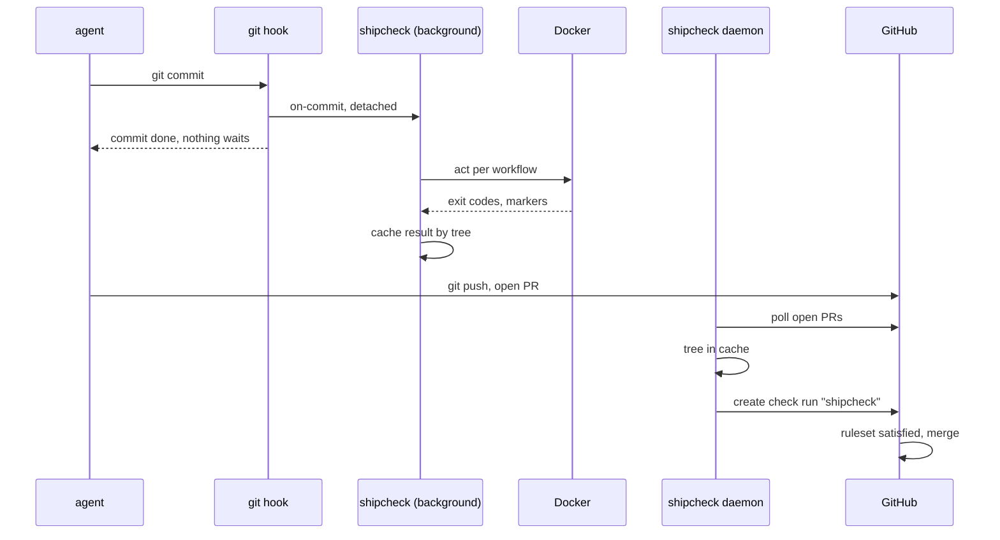

# shipcheck architecture

The parts of shipcheck and how they talk. [DESIGN.md](DESIGN.md) says why. [PROOF.md](PROOF.md) says when a check passes. User docs are in `site/content/docs`.

## Components

| Component | Runs as | Does |
|---|---|---|
| `shipcheck` | the developer, an agent or a hook | One binary. Runs workflows with `act` in copy-on-write checkouts, caches results by tree, posts checks, and runs the daemon |
| Git hooks | git, in each clone | `pre-push` and `post-commit`, written by `shipcheck install`. They start background runs and never block git |
| Agent hooks | the coding agent, in each clone | `shipcheck hook <agent> <event>`, written by `shipcheck install` into each detected agent's config. They deny test runners and `git commit` and block a stop with work left |
| `shipcheck daemon` | the developer's user, started once through `passbox exec` | Polls GitHub for open PR heads and posts the `shipcheck` check from cached results |
| Docker engine | the developer's user | Docker Desktop, OrbStack or colima |
| shipcheck.run GitHub App | GitHub | Checks write, Contents read, Metadata read, Pull requests read, Merge queues read. No webhook. One App, ours. Its key lives in the hosted service, and on the author's machines for the daemon |
| Hosted service | Cloudflare Worker at `api.shipcheck.run` | Signs machines in and posts the `shipcheck` check for `shipcheck post` on machines without an App key |
| Ruleset on `main` | GitHub | Requires the `shipcheck` check from the App, and up-to-date branches |
| Workflows | GitHub Actions | Unchanged. They run on `push` to `main` as before, which is the backstop |

## Flows

**A run.** `shipcheck run`, or a background run started by a hook:

0. With no `--sha`, picks what to test. The working copy, or the index with `--staged`, becomes a tree built in a copy of the index (`add -A` for the working copy, then `write-tree`), and a commit no ref names with `HEAD` as parent (`commit-tree`), so the checkout below has a commit to check out. The real index, branches and stash stay as they are. A tree equal to `HEAD`'s tests `HEAD`. The run prints the untracked files it includes, and records what it tested in `tested/<id>.json`.
1. Fetches `origin/main`, unless `--no-fetch`, and reads `shipcheck.toml` and `.github/workflows/` there.
2. If `paths` is set and no changed file matches, answers with a pass that ran nothing (PROOF.md).
3. Computes the cache key (PROOF.md). A cached pass answers at once. A cached failure runs again.
4. Takes the per-tree lock, so a second request for the same tree waits and reads the result, then a machine-wide run slot.
5. Takes a slot, `runs/<owner>/<repo>/<n>`, and runs every workflow in `workflows` at the same time, as GitHub does. In each, it starts every job whose `needs` have passed, and all jobs of the run together stay within `max_parallel`. A job whose need failed does not run, one whose need was skipped is skipped.
6. Each job gets its own checkout, made with `git_cow::add_with` from its own template at a fixed path, `runs/<owner>/<repo>/<n>/<file>/<job>`. shipcheck writes the workflow files from step 1 into it unchanged, writes the prepared copy with the injected steps beside it, and deletes `.actrc`, `.env`, `.secrets`, `.vars` and `.input`. `ubuntu-latest`, `ubuntu-24.04` and `ubuntu-22.04` get catthehacker images pinned by digest unless `[act] platforms` maps them, so act never asks for a default image.
7. Runs `act -j <job>` in it, with `retries`, reads the markers and the job's outputs from its log, then warms the job's template with `git_cow::warm` and removes the checkout.
8. Writes the cache entry and the logs, one per job and one per workflow.

**A commit of what ran.** `shipcheck commit -m <message>` reads `tested/<id>.json`, builds the tree again in a copy of the index by the same rules, and refuses if it differs from the tested tree or the run failed (unless `--allow-failed`). Otherwise it runs `git commit` with `GIT_INDEX_FILE` on that copy, so hooks, signing, author and the branch update are git's own, then moves the copy over the real index. A refusal leaves the real index untouched. The commit hook and `shipcheck post` then find the result by tree.

**Background runs.** The hooks call `shipcheck on-commit` and `shipcheck on-push <ref> <sha>`. Each one checks `on`, then starts `shipcheck run --no-fetch --sha <sha>` detached, in its own process group, with git's hook variables (`GIT_DIR`, `GIT_INDEX_FILE` and others) removed, and returns. One background run per repository and branch is recorded in `background/<owner>/<repo>/<branch>.pid` as `<process group> <sha>`. A newer commit sends `SIGTERM` to the older group first. A request for the commit already running leaves it alone. Output goes to `logs/background.log`.

**An agent's hooks.** The agent calls `shipcheck hook <agent> pre-tool` before a shell command or a file edit, and `shipcheck hook <agent> stop` when it wants to end its turn, with its JSON on stdin. Agent integration below has the details.

**The daemon.** Every `interval_seconds`, per repository in `daemon.toml`:

1. Lists open PRs into the configured branch. PRs into other branches are skipped, since `shipcheck.toml` on `main` says nothing about them.
2. For each head without a completed `shipcheck` check from our App: fetches the commit if needed (`pull/<n>/head`) and looks up its result.
3. On a result, posts it. On none, runs it if `run_misses = true` and the PR is not from a fork, and otherwise waits for a local run. A fork's code never runs on our machine.
4. While it waits, the check shows `in_progress` if a run of that tree holds its lock on this machine, and `queued` if none does. The result completes the same check run.



## State

Under `~/Library/Application Support/shipcheck` on macOS and `$XDG_STATE_HOME/shipcheck` on Linux, or `SHIPCHECK_HOME`.

| Path | Holds |
|---|---|
| `app.pem` | The App's private key, mode `0600`. Or `SHIPCHECK_APP_KEY_FILE`. The App ID comes from `SHIPCHECK_APP_ID`, injected by passbox |
| `token` | The hosted service's machine token from `shipcheck login`, mode `0600`. `SHIPCHECK_TOKEN` overrides it, `SHIPCHECK_API` changes the service URL |
| `daemon.toml` | `interval_seconds` (10), `run_misses` (false), and `[repos]` as `"owner/repo" = { path = "<clone>", base = "origin/main" }` |
| `secrets/<owner>/<repo>.env` | Secrets passed to `act` with `--secret-file`. Never from the commit |
| `templates/<owner>/<repo>/<file>/<job>/` | One git-cow warm template per job, fed only by shipcheck's runs |
| `runs/<owner>/<repo>/<n>/<file>/<job>/` | Job checkouts at fixed paths per slot and job, `<n>.lock` held during a run |
| `actcache/<owner>/<repo>/` | act's `actions/cache` server, one per repository instead of act's machine-wide `~/.cache/actcache` |
| `runs/<owner>/<repo>/<n>.artifacts/<file>/` | The artifact directory of one workflow run, shared by its jobs |
| `cache/<key>.json` | One result per cache key |
| `locks/<key>.lock` | Held while a tree runs |
| `runners/<n>.lock` | Machine-wide run slots, `SHIPCHECK_MAX_RUNS` of them, a quarter of the CPUs by default |
| `background/<owner>/<repo>/<branch>.pid` | The background run of each branch, for cancel-in-progress |
| `tested/<id>.json` | What the last `shipcheck run` of a worktree tested: tree, `--staged` or not, pass or fail. `<id>` is a SHA-256 prefix of the worktree path. Read by `shipcheck commit` |
| `logs/<key>/<workflow>.log` | Full workflow logs. `logs/background.log` for background runs |

`owner/repo` comes from the `origin` URL, with `.` and `..` refused, so no state path leaves the state directory.

Rejected: a daemon with a socket that every run goes through. The per-tree lock and the run slots give the same queueing and sharing between processes, so the daemon only does what needs the App.

## Repository config: `shipcheck.toml`

Written by the repository owner, read from `origin/main` only. The settings follow a workflow's inputs: `workflows`, `on`, `paths`, `timeout_minutes`, `retries`, `max_parallel`, `shard_tests`, and `[act]` for `platforms` and `cache_paths`. The reference is `site/content/docs/config.md`.

The unit is the workflow file. Every job in a listed workflow runs, so a job added later is covered without a config change. Rejected: one entry per job, because `act -j <job>` also runs the jobs in its `needs`, so shared jobs ran once per dependent. Rejected: a second list, `main_only`, that every workflow must appear in. It made the owner keep two lists.

`paths` lists changed files with `git -c core.quotePath=false diff --no-renames --name-only -z <base>...<sha>`, so a quoted name or the old side of a rename cannot slip past the filter. A name that is not UTF-8 means run.

`shipcheck init` writes `runner = "host"` with checks and `versions` detected from the root's project files: `package.json` `test` and `lint` scripts run with the package manager of the lockfile (`bun.lock`, `pnpm-lock.yaml`, `yarn.lock`, else npm), `Cargo.toml` gives `cargo test` and `cargo clippy --all-targets -- -D warnings`, `pyproject.toml` gives `pytest`, or `uv run pytest` with `uv.lock`, and `go.mod` gives `go test ./...` and `go vet ./...`. A name taken by an earlier ecosystem gets the tool's name after it, such as `test-go`. With none of these it writes `runner = "act"` with every workflow listed and `shard_tests = true`, and says why. The owner removes deploys and anything else that must not run on a laptop. That file also holds host checks guessed from the workflows' one-line run steps, without setup commands or expressions, all commented out. A job id outside GitHub's grammar or a command with a control character is skipped, so nothing escapes the comment.

`runner = "host"` replaces `workflows` with `[host] checks`, a table of name to shell command, `versions`, commands whose output goes into the key, and `env`, variable names passed through. Validation refuses settings that do not fit the mode: `shard_tests`, `network` or `[act]` set under host, read from the raw table since defaults hide them, workflows set under host, `[host]` set under act, no checks, a name that is not a job id, an empty command, a credential-carrying `env` name.

## Host runner

`src/runner/host.rs`. The run is one result named `host` whose jobs are the checks, so the cache entry, `shipcheck logs`, `report` and the check body stay as they are. `run::run_host` starts every check at once under `max_parallel` and each goes through `run_job`, so checkouts, the standalone `.git`, retries, attempt logs and warming are shared with act. What differs:

| Step | Host mode |
|---|---|
| Template | git-cow warms it from the developer's checkout at most hourly, its default. act mode writes git-cow's stamp so that never happens |
| Files from the base | None written into the clone, since no workflow runs |
| Sandbox | `sandbox-exec -p <profile>` on macOS, `bwrap <args> --` on Linux, built per command by `Jail` in `src/runner/host.rs`. Writable: the clone, a new temp home, and `SHIPCHECK_HOME/hostcache/<owner>/<repo>/base` or `branches`, by whether the tree is the base's. `preflight` refuses the run when neither sandbox works (SECURITY.md) |
| Process | `sh -c <command>` in the clone, inside the sandbox, stdin `/dev/null`, stdout and stderr to the check's log, `setsid` so it has its own session and process group. `killpg(SIGKILL)` after it exits and at the timeout |
| Environment | Cleared, then the allowlist and `[host] env` (SECURITY.md), `CI=true`, and `HOME`, `TMPDIR` and the tool cache variables pointed into the jail |
| Identity | `host` and each `versions` command with its stdout, run in the repository in the sandbox with a temp home, the repository readable, 5 s each at most, a failure fails the plan |
| `reclaim`, `clean` | `reclaim` does nothing: the process group is gone when `run` returns. `clean` removes the repository's `hostcache`, and the templates go with the repository's |
| Result | `success` on exit 0, `timed out`, or `failure`. The run passes when every check succeeds |

`ci_changes` adds, in both modes, since a workflow's `run: npm test` reads the branch's `package.json` too, each file changed since the merge base whose part that defines a check changed: `package.json` `scripts`, `pyproject.toml` `[tool]`, `Cargo.toml` without dependency tables and `package.version`, and whole `Makefile`, `justfile` and `.cargo/config.toml`. A file that does not parse counts whole. The daemon returns before posting anything for a fork's PR in host mode.

## act invocation

```
cd <job checkout> && act workflow_dispatch \
  -W .github/workflows/<file> -j <job> \
  -P <platform>=<image@digest> \
  --bind --pull=false --rm \
  --container-options "-v shipcheck-<home hash>-<owner>-<repo>-<hash>-<path>:<path> ..." \
  --secret-file <secrets file or /dev/null> \
  -s GITHUB_TOKEN= --container-daemon-socket - --no-cache-server \
  --env-file /dev/null --var-file /dev/null --input-file /dev/null
```

| Flag | Why |
|---|---|
| `-j <job>` | One act process per job, so each job has its own checkout as on GitHub. act would also run the job's `needs`, so the job's copy drops `needs`, and `needs.<job>.outputs.<name>` and `needs.<job>.result` become literals. Any other use of `needs`, such as `toJSON(needs)`, fails the job. A last injected step prints the job's `outputs`, hex-encoded, for the jobs that need it. The workflow `name` gets a tag of the checkout's path, since act names containers after workflow and job and removes an older container of that name |
| `--bind` | Mounts the job checkout instead of copying it, which keeps the copy-on-write gain |
| `--pull=false` | Pinned images never need a registry check |
| `--rm` | Without it, act leaves the container of a failed job running |
| `--container-options -v` | A Docker volume per repository for each of `cache_paths`, so package caches survive between runs. Only caches that lock themselves: parallel jobs share the volumes, and two rustup installs into one shared `~/.rustup` broke each other in the oblivion trial, and so did cargo, whose lock sits at the root of `~/.cargo` outside the shared directories. act keeps `/opt/hostedtoolcache` in its own volume. A volume per repository, slot and job for each of `slot_paths`, for caches that do not lock themselves, since jobs in one slot run one at a time. `/var/lib/apt/lists` is one, since apt fails on a held lock instead of waiting: `apt-get update` then checks the lists instead of downloading 36 MB of them. "Package caches" below lists each language's. And a new anonymous volume at the checkout's `.venv`, which act's `--rm` removes with the container: a Python venv off the macOS bind mount, empty each run so no state carries over. Rejected: `UV_PROJECT_ENVIRONMENT` in a job home, which broke tools that look for `.venv`, such as basedpyright, and kept the venv across commits. Cost: every checkout gets an empty `.venv` mountpoint, which a script that tests for `.venv` would see |
| `--network none` or `--network <run network>` | `none` is the default, `network = "none"`. act's own default is the host's network, which reaches every service on the machine and the LAN. `network = "internet"` creates a bridge network per act process, `shipcheck-<home>-net-<tag>`, which `reclaim` and `shipcheck clean` remove, see SECURITY.md |
| `--container-daemon-socket -` | act mounts the host's Docker socket into every job by default, and a job with the socket owns the host: every file, the App key, the secrets, the cache. Jobs that build images or start containers need an opt-in, not built yet |
| `--no-cache-server` | act's `actions/cache` server listens on the LAN address with no authentication, and every branch shares it, so a stranger on the network or an earlier commit could plant what a later run restores. The warm checkout per job replaces it, and `actions/cache` steps miss. Its old directory, `actcache/<owner>/<repo>`, is still removed by `shipcheck clean` |
| `-s GITHUB_TOKEN=` and a cleared environment | act fills an unset `GITHUB_TOKEN` secret from the host's token, and would pass a host `GITHUB_TOKEN` to jobs. act gets only `PATH`, `HOME`, `USER`, `TMPDIR`, locale, `XDG_CACHE_HOME` and `DOCKER_*` |
| `/dev/null` files | act would otherwise read `.env`, `.secrets`, `.vars` and `.input` from the commit |
| `--artifact-server-path`, `--artifact-server-port` | Jobs pass build output through `upload-artifact`. A directory per workflow run that every job's act process shares, emptied for each run, and a free port per act process, since act's fixed default port would let concurrent runs share a server. act listens on the machine's LAN address by default, so `--artifact-server-addr` is `127.0.0.1`, reached on a Mac through `host.docker.internal` and `ACTIONS_RUNTIME_URL`. On Linux a bridge container cannot reach the host's loopback, so an internet run binds the run network's gateway, which act also gives jobs as the server's address |

`act --version` runs from `/`, so a repository's `.actrc` cannot change the version that goes into the key.

A job checkout sits at a fixed path per repository, slot and job, because builds embed absolute paths, such as cargo's `CARGO_BIN_EXE_*`. Rejected: a new path per run, which failed git-cow's own CLI tests on every warm run. The template is fed only by shipcheck's runs, since host builds from the developer's checkout break in a Linux container.

Rejected for now: `act --reuse`, which keeps containers between runs. A run would start from the previous run's files and packages, so a result could depend on the previous commit. It may come back as an opt-in setting if the oblivion trial shows container setup is a large share of a run.

## Package caches

`actions/cache` always misses under `--no-cache-server`, so a setup action's `cache:` input restores nothing, and every cache outside a volume downloads again each run. Each default below keeps one. Shared means a `cache_paths` volume, slot means a `slot_paths` volume, home means an `act.job_homes` directory per job. A language's caches are mounted only when the tested tree has one of its files, read with `git ls-tree` at plan time, so a Python repository gets no Maven or Gradle volume. Rejected: mounting every language's caches in every job, which made flask's warm runs 7 s slower with eight empty volumes each (BENCHMARKS.md). The npm, bun, `/root/.cache`, apt and Rust entries are always on. A list the owner sets in `shipcheck.toml` is used exactly as written.

| Tool | Files | Path in the job | Kept as | Why |
|---|---|---|---|---|
| npm | always | `/root/.npm` | shared | cacache writes a temp file and renames it, and checks each index line's hash |
| bun | always | `/root/.bun/install/cache` | shared | Extracts under a random name and renames, the first writer wins |
| yarn v1 | `yarn.lock` | `/usr/local/share/.cache/yarn`, its default for root | slot | Extracts into its cache with no lock (yarnpkg/yarn#4102), and its default `--mutex` is a localhost port that another container never sees. Rejected: `YARN_CACHE_FOLDER` in a home, which berry also reads, so a zero-install repository would stop using its committed `.yarn/cache` |
| yarn berry 4 | `yarn.lock` | `/root/.yarn/berry/cache` | shared | Writes a random temp name and renames, and never cleans a global cache. Berry 3 keeps its cache in the checkout |
| pnpm | `pnpm-lock.yaml` | `npm_config_store_dir` | home | Writes are atomic, but `pnpm store prune`, which `pnpm/action-setup` runs after `run_install`, deletes every store file with one link, and a store on another filesystem than `node_modules` holds only such files |
| nub | any JavaScript lockfile, since setup-nub installs from each | `/root/.local/share/nub`, its store | slot | Locking unchecked. zod's CI downloaded its 1,093 packages again on every run, and registry stream errors failed the install |
| Go | `go.sum`, `go.mod` | `/root/go/pkg/mod`, and `/root/.cache/go-build` in `/root/.cache` | shared | flock per module version and on the build cache. setup-go sets neither path |
| Maven | `pom.xml` | `/root/.m2` | slot | Maven 3.9's default lock, `rwlock-local`, covers one process |
| Gradle | `build.gradle`, `settings.gradle`, with or without `.kts` | `/root/.gradle` | slot | A process asks the holder for a lock by a UDP ping to localhost, which another container never gets, so it fails after 60 seconds (gradle/gradle#851) |
| sbt | `build.sbt` | `/root/.sbt`, and coursier in `/root/.cache` | slot, shared | coursier takes an OS lock per file. sbt's own locks are unchecked |
| Composer | `composer.lock`, `composer.json` | `COMPOSER_CACHE_DIR` | home | Copies dist zips in place with no lock, and its random cleanup can delete a file another job reads |
| Bundler | `Gemfile.lock`, `Gemfile`, `*.gemspec` | `BUNDLE_USER_CACHE` | home | The compact index writes a temp file named after the PID, which two containers can share. setup-ruby installs gems in `vendor/bundle`, which the warm template keeps when it is gitignored |
| Hex, Mix, rebar3 | `mix.lock`, `mix.exs`, `rebar.config` | `HEX_HOME`, `MIX_HOME`, `REBAR_CACHE_DIR` | home | Hex's registry uses a PID temp name and rebar3 writes in place. rebar3 would use `/root/.cache/rebar3` otherwise |
| Dart | `pubspec.lock`, `pubspec.yaml` | `/root/.pub-cache` | shared | Extracts to a temp dir and renames. setup-dart sets `PUB_CACHE` to this path, so a home would be overwritten |
| NuGet | `*.csproj`, `*.fsproj`, `*.sln`, `global.json` | `/root/.nuget` | shared | Extracts under a lock file in `~/.nuget/lock`, which is why the volume is all of `~/.nuget` |

Apart from `pnpm/action-setup`'s prune, which shipcheck moves aside (Injected steps), no setup action above deletes a cache on a miss as setup-uv did. A home is per job id, so two slots that run the same job at once share it, as with `RUSTUP_HOME`. Rejected for Gradle: one shared home with `GRADLE_RO_DEP_CACHE`, which needs a read-only copy that no running build writes. Cost: a slot volume holds a copy of its cache per slot and job, so disk grows with both: a repository whose runs used 3 slots keeps 3 Maven repositories per job. `slot_paths` in `shipcheck.toml` drops a path, and `shipcheck clean` removes the volumes.

## Injected steps

Before a run, shipcheck edits its copy of each workflow, never the repository's. It adds `workflow_dispatch:` to the triggers, so `act workflow_dispatch` runs a workflow that on GitHub runs only on `push` to `main`. Each job with `steps:` gets a first and a last step:

```yaml
- name: shipcheck start
  run: echo "shipcheck-start <nonce> ${{ github.job }}"
# ... the job's own steps ...
- name: shipcheck end
  if: always()
  run: echo "shipcheck-end <nonce> ${{ github.job }} ${{ job.status }}"
```

The nonce is new for each run, so test output cannot be mistaken for a marker. A job that started with no end marker was killed. A job with no markers was skipped by its own `if:`. A job act skipped as an unsupported platform fails the workflow. A job with `continue-on-error: true` that fails, is killed or times out does not fail the workflow, as on GitHub, and the jobs that need it still run. Jobs that call a reusable workflow have no steps and get no markers.

Before `shipcheck start`, the act runner adds one more step: it checks that `.git/shipcheck-nonce` in the job's workspace holds the value written for this job a moment before. OrbStack has shown a job the files the previous run left at the same path, and colima shows an empty directory for a path outside the home directory. Both fail this step, and act exits non-zero, so the job fails instead of passing on a tree it never tested. The nonce is in two places, `.git/shipcheck-nonce` and `.shipcheck-nonce` at the checkout's root, listed in `.git/info/exclude` so `git status` stays clean, and the step says whether it saw an older checkout or none. Docker Desktop shows a path as the last container saw it for about a second: a retry, which empties and clones the same path right after the failed attempt, saw the attempt before's nonce or a missing tracked file in 3 of 5 retries. So a job starts at least 2 s after the last containers at its checkout's path were removed, by a retry or by an earlier run in the same slot, read from a stamp per checkout in `runs/<owner>/<repo>/<n>.ended/`, beside the slot a new run deletes. The retry gap alone made 50 retries in 10 runs clean. Rejected: waiting inside the job for the nonce, since a fresh nonce came with a stale `.github/workflows/ci.yml`, and two paths per slot taken in turn, which would break the absolute paths warm builds embed. Cost: 2 s per retry, minus the checkout time.

Each `astral-sh/setup-uv` step gets `prune-cache: false`, in the job's workflow and in the local composite actions (`uses: ./dir`) it reaches, whose `action.yml` is rewritten in the job's checkout. setup-uv prunes its cache when its `actions/cache` restore misses, and every restore misses with `--no-cache-server`, so each run deleted 2.1 GB of wheels and downloaded 215 packages again. Only cache cleanup changes. The tree and the key come from git, which never sees the copy. An action reached through a symlink, or one with YAML aliases, is left alone. `pnpm/action-setup` has no input to stop its prune, which runs `pnpm store prune` after any `run_install` and empties a store that `node_modules` only copies from (Package caches). So `run_install` comes off the step, and each install becomes a `run` step after it, `pnpm [recursive] install <args>` in its `cwd`, with the step's `if`, `env` and `continue-on-error`. An expression in `run_install`, or a value the action would refuse, leaves the step alone. Cost: a job that runs `git diff` sees the edited `action.yml`, and a failed install fails the new step, not the setup step. Rejected: reopening act's cache server (`--no-cache-server` below), and `INPUT_PRUNE-CACHE` in the job's env, which act drops for composite actions.

With `shard_tests` set, a job's pytest step is replaced by a bash wrapper (`src/runner/shard.rs`). The step qualifies when it is one line, runs in bash, holds none of `; & | < > $ \` ( ) \`, starts with `pytest`, `uv run [--flag ...] pytest`, `poetry run pytest`, `pdm run pytest` or `python[3] -m pytest`, uses no pytest-xdist flag, and is the only such step in its job. The step name gets ` (shipcheck: N shards)`. For a sharded attempt the host writes the plugin `shipcheck_shard.py`, built into the binary, and the shard count into `.git/shipcheck-plugin/` of the job's checkout, next to the nonce. The count is the fixed number, or the least of the engine's CPUs, its memory at 1.5 GiB a shard and 6, from `docker info`, so it never enters the workflow copy or the key. On a Mac's 8 GB Docker VM memory sets it, at 5. Without that file the wrapper runs the line as it is, which is how the unsharded rerun runs. With it, the wrapper starts the line N times with `SHIPCHECK_SHARD=i/N`, `-p shipcheck_shard` in `PYTEST_ADDOPTS` and the plugin on `PYTHONPATH`, then prints each shard's output in order in a `::group::` and a summary of exit codes, item counts and failed node ids, and exits 0 only if every shard did. The plugin wraps `pytest_collection_modifyitems` after every other hook, so `-m`, `-k` and `--deselect` have filtered, gives shard i every N-th item in collection order, and writes `.git/shipcheck-shards/<i>.json` with the digest of all collected node ids and each item it ran with its outcome. An empty shard of a suite with tests exits 0. It removes its variables at import and restores the user's `PYTEST_ADDOPTS`, so a pytest that a test starts runs whole. After act exits and the job's containers are removed, `run.rs` reads exactly N reports with `openat` and `O_NOFOLLOW`, requires regular files and caps their size, and checks them (PROOF.md). Rejection reasons are a fixed enum, so no report text reaches the check. A rejected attempt keeps its log as `<job>.attempt-<n>.log` and the job runs again unsharded. The plugin's digest is a comment in the wrapper, so a new plugin changes the key.

The edit uses `yaml-rust2`, a YAML 1.2 parser, where `on` stays a string. Rejected: inserting text into the YAML, which breaks on flow style and anchors. Rejected: parsing act's own log format for job results, which ties shipcheck to one runner.

## Matrix jobs

act 0.2.89 evaluates `runs-on: ${{ matrix.os }}` at random across the legs of a matrix. So shipcheck expands every static matrix itself, by GitHub's rules: the product of the axes, minus `exclude`, then `include` entries that extend the combinations they do not overwrite or become new ones. Each leg becomes a job `<id>__<n>` with a one-entry matrix and a literal `runs-on` and `continue-on-error`, and `needs:` on the original job is rewritten to all its legs. A matrix built from an expression is left to act.

`needs.<id>.outputs` of a matrix job resolve under its old id to the outputs of its legs, the last leg winning, as on GitHub.

## Where jobs run

Linux jobs run in Linux containers. shipcheck never runs a job on the host, so `-self-hosted` platforms are refused and macOS and Windows jobs stay on GitHub. When act skips a job as an unsupported platform, the workflow fails with `no image for its runs-on label on this host`, which also covers a Linux label with no image in `[act] platforms`.

The checkout keeps the base's workflow files unchanged, only the top-level `.yml` and `.yaml` files replaced, so a job that runs `git diff` sees no change and the scripts and data next to them stay. The prepared workflow that act runs sits beside the checkout, `<job>.workflows/<file>`, passed with `-W`. The job's repository has a branch `shipcheck` at the tested commit, so `github.ref` is `refs/heads/shipcheck`. Each job gets its own `RUNNER_TOOL_CACHE` through `job_homes`, since act's one tool cache for every job gave parallel setup actions half-copied installs. `git worktree` changes for a repository hold one lock file, across processes, so a prune never deletes another job's half-made worktree.

A workflow that mixes macOS host jobs and Linux container jobs shares one run directory between them. Tart VMs for macOS jobs would separate them.

## Check run

One check run named `shipcheck` on the commit, posted with an installation token of the App. The summary holds the manifest from PROOF.md as a table. Log tails of failed jobs go into the check only with `logs = "failed"` in `shipcheck.toml` on main, or `shipcheck post --with-logs`, since a log can hold paths, names or secrets act did not mask, and a check on a public repository is public.

When the commit changes `.github/workflows/`, `shipcheck.toml` or a file that defines what a command runs (Host runner) since its merge base with the base, the title ends in ", changes CI" and the summary lists each changed file, and each job or step a change lets fail (`continue-on-error`) or never runs (`if: false`), and each job or step it removes. The base's versions are what ran, so this never changes the conclusion. It tells the reviewer what the PR does to CI for everyone once merged. Rejected: comparing with the base itself, which blames a branch that is behind for the base's newer edits.

## Hosted service

A Cloudflare Worker with one D1 table, `tokens`: the SHA-256 of each machine token, the GitHub user id and login, the machine name, the time it was made and the time it expires, 90 days after its last use. It stores nothing else.

| Endpoint | Auth | Does |
|---|---|---|
| `GET /v1/login` | none | Returns the App's public client id, for the device flow |
| `POST /v1/login` | `{token, machine}` with a GitHub user token | Asks GitHub, with the App's client secret (`POST /applications/{client_id}/token`), whether our App issued the token and to whom. A PAT or another App's token is refused. Drops the token, stores a new machine token's hash and returns `{token, login, expires}` |
| `DELETE /v1/login` | machine token | Deletes that token |
| `POST /v1/checks` | machine token | `{repo, sha, check, check_id?}`: posts the check, returns `{id, html_url}` |

`POST /v1/checks` in order:

1. Finds the machine token, refused with 401 if unknown or expired. An expired row is deleted.
2. Accepts only a body that `src/check.rs` builds: `name` is `shipcheck`, `head_sha` equals `sha` (40 hex), only the fields check.rs writes, each output field within GitHub's 65,535 characters, the request within 512 KiB. Anything else is a 400, before any GitHub call.
3. Signs an App JWT (RS256, WebCrypto) and finds the App's installation on `repo`, a 404 if there is none.
4. Mints an installation token for that one repository with `checks: write` and `metadata: read`.
5. Reads the user's permission on `repo` with that token. Only `admin` and `write` pass, and GitHub reports maintain as `write`. The user id must match the stored one, since a renamed login can pass to someone else.
6. Creates the check run. With `check_id`, it updates that run instead, only if it is this App's `shipcheck` run on the same commit. A post that passed step 5 gives the token 90 more days, written at most once a day.

Every error is JSON, `{error}`, with a status code: 400 and 413 for the body, 401 for the token, 403 for the permission, 404 for the App, 502 when GitHub refuses, 500 for anything else.

Tests, all run by the CI `service` job, which `deploy-service.yml` waits on:

| Suite | Runs | Fakes |
|---|---|---|
| `bun run test` (`src/index.test.ts`) | `handle` in bun | GitHub's API through `fetch`, and D1 through an in-memory `Store` |
| `bun run test:worker` (`test/worker.test.ts`) | The Worker bundled by `Bun.build`, in workerd through Miniflare, with a local D1 that has `migrations/` applied, over HTTP | GitHub's API only, through Miniflare's outbound service, with a generated App key |
| `scripts/e2e.sh` | The live service, by hand: `shipcheck login`, `run`, `post`, `logout` on a throwaway repository, then `gh api` reads the check run | Nothing |

The Worker suite drives Miniflare from bun. `@cloudflare/vitest-pool-workers` was rejected: it adds vitest and a second copy of wrangler and Miniflare, and runs under Node. The cost is Miniflare's lower-level API: under bun, `dispatchFetch` connects to the request's host, so the tests fetch the port Miniflare listens on, and the tests split migrations on `;`.

Dependencies, all for development: `wrangler`, `miniflare` (the copy wrangler uses), `@cloudflare/workers-types`, `typescript`, `@types/bun`. The Worker itself imports nothing.

## Team setup

| Part | Installed | Does |
|---|---|---|
| The GitHub App and the ruleset | Once per repository, by the owner | The gate. Every PR needs the `shipcheck` check to merge |
| `shipcheck.toml` | Committed by `shipcheck init` | What must pass, and when runs start |
| The hooks | Once per clone, by `shipcheck install` | Start background runs on commit and push, so the result is cached before the PR exists. Git never installs hooks on clone, so each clone needs this one step |

The hooks live in `.git/hooks`, written from the binary. Rejected: a committed `.githooks/` with `core.hooksPath`, the husky pattern, because any branch checked out could change the code that runs on the next push. When another hook manager owns the hooks, `install` leaves them alone and prints the line to add.

An agent that skips the hooks with `--no-verify` still cannot merge: the check comes only from results shipcheck produced.

## Agent integration

Two layers, both written from the binary.

**Instructions.** `shipcheck init` writes one block between `<!-- shipcheck:start v1 -->` and `<!-- shipcheck:end -->` into the files the agents read, to be committed. It replaces the text between the markers, else appends, and writes nothing when the file is current.

| File | When |
|---|---|
| `AGENTS.md` | Always, created if missing |
| `CLAUDE.md`, `.claude/CLAUDE.md` | When it exists and has no `@AGENTS.md` line. Claude Code reads only CLAUDE.md when both exist |
| `GEMINI.md` | When it exists. Otherwise `AGENTS.md` is added to `context.fileName` in `.gemini/settings.json`, when that file exists |
| `.github/copilot-instructions.md` | When it exists |
| `.aider.conf.yml` | When it exists: `read: AGENTS.md`. A `read:` key already there is left for the user, with a note |

`install` also writes `SKILL.md` with a `<!-- shipcheck-skill <version> -->` line to `~/.claude/skills/shipcheck/` when `~/.claude` exists, and to `~/.agents/skills/shipcheck/` when `~/.agents` or `~/.codex` exists.

**Hooks.** `shipcheck install` writes these for each agent it detects, by a binary on `PATH` or a config directory in the home or the clone. JSON is merged: entries whose command starts with `shipcheck hook` are replaced, the rest stay. A file that does not parse, a tracked file, and a path that is a symlink, sits under one or resolves outside the clone are left alone with a note, since a cloned repository can ship `AGENTS.md` or `.claude` as a link to `~/.zshrc`. Writes in the clone, `shipcheck.toml` and `.git/info/exclude` included, open with `O_NOFOLLOW`. Each file it writes goes in `.git/info/exclude` unless gitignored, so a run of the working copy never includes it.

| Agent | File | Events |
|---|---|---|
| Claude Code | `.claude/settings.local.json` | `PreToolUse` on `Bash\|Edit\|Write\|MultiEdit\|NotebookEdit`, `Stop`. Also `permissions.deny` of `Edit` under the home and `Read` of its `token`, `app.pem` and `secrets/`, and `sandbox.excludedCommands` with only `shipcheck run`, `commit`, `status`, `logs` and `doctor`. An install over an older one drops its `shipcheck *` |
| Codex | `.codex/hooks.json`, `.codex/rules/shipcheck.rules` | `PreToolUse` on `Bash`, `Stop`. The rules allow only `shipcheck run`, `commit`, `status`, `logs` and `doctor` outside the sandbox, never `clean`, `post`, `daemon` or `login`. The hook also denies `shipcheck run --base`, which would let the agent pick the config of a run outside its sandbox. The home is never a writable root |
| Cursor | `.cursor/hooks.json` | `beforeShellExecution`, `preToolUse` on `Write\|Delete`, `stop`. Cursor does not document the path field of its Write tool, so the hook checks every string under a key whose name holds `path` or `file`, at any depth and in lists |
| Gemini CLI | `.gemini/settings.json` | `BeforeTool` on `run_shell_command\|write_file\|replace`, `AfterAgent` |
| Copilot CLI | `.github/hooks/shipcheck.json` | `preToolUse`, `agentStop` |

`pre-tool` splits the command on `&&`, `||`, `;`, `|`, `&` and parentheses outside quotes, and drops `VAR=value`, `env` and the like in front. It denies, only when `origin/main` has `shipcheck.toml`:

- a test runner: `pytest`, `python -m pytest`, `uv`, `poetry` or `pdm run pytest`, `cargo test`, `cargo nextest`, `npm`, `pnpm`, `yarn` or `bun test` and `run test`, `go test`, `just test`, `make test`, `tox`, `nox`, `jest`, `vitest`, `act`. Builds, linters and formatters pass.
- `git commit`, unless a merge, cherry-pick, revert or rebase is in progress.

In every repository it denies an edit of a path under the home in use or the default home, resolving each symlink, the last one and dangling ones too, before the `..` after it. A `..` below a directory that does not exist yet, or links nested too deep, count as inside. It also denies a shell command that names either home (as written, escaped, resolved or from `~`), sets `SHIPCHECK_HOME`, `HOME` or `XDG_STATE_HOME` with `=` or `+=`, names `api.shipcheck.run`, puts a variable, `env` or `command` in front of `shipcheck`, or holds `--home-ok` anywhere. These text checks catch habits by design (SECURITY.md). `SHIPCHECK_ALLOW_TESTS=1` in the agent's environment allows everything. `sh -c '...'`, `$(...)` and variables are not looked into.

`stop` allows when `origin/main` has no `shipcheck.toml`, when anything fails, and when the agent is already continuing from a block (`stop_hook_active`, or Cursor's `loop_count` above 0 or a status other than `completed`). Otherwise it blocks once when the working copy is dirty, when HEAD is ahead of `origin/main` and its tree has no result, or when that result failed. It reads the cache and never runs CI.

| Agent | Deny a tool | Block a stop |
|---|---|---|
| Claude Code, Codex | `{"hookSpecificOutput":{"hookEventName":"PreToolUse","permissionDecision":"deny","permissionDecisionReason":"..."}}` | `{"decision":"block","reason":"..."}` |
| Cursor, by the `hook_event_name` it sends | `beforeShellExecution` and `preToolUse`: `{"permission":"deny","user_message":"...","agent_message":"..."}`, and `{"permission":"allow"}` otherwise. Any other event gets no reply | `{"followup_message":"..."}` |
| Gemini CLI | `{"decision":"deny","reason":"..."}` | `{"decision":"deny","reason":"..."}` |
| Copilot CLI | `{"permissionDecision":"deny","permissionDecisionReason":"..."}` | `{"decision":"block","reason":"..."}` |

The hook always exits 0 and prints nothing to allow, so a missing or broken shipcheck never stops the agent. `doctor` adds a note per detected agent: the block's version in AGENTS.md, CLAUDE.md, the hook config, the Codex rule, the skill version, and what protects the home from it.

## CLI

| Command | Does |
|---|---|
| `shipcheck run [--sha <rev> \| --staged] [--no-fetch] [--base <ref>]` | Runs in the foreground and waits. With no `--sha`, tests the working copy, or the index with `--staged`, and prints `tested the working copy, tree <id>` or `tested <sha>, tree <id>`. Exit 0 pass, 1 fail, 2 error |
| `shipcheck commit -m <message> \| -F <file> [--allow-failed] [--no-verify]` | Commits exactly the tree the last run of this worktree tested, through `git commit`. Exit 2 when files changed since the run or the run failed |
| `shipcheck status [<rev> \| --staged]` | The stored result of what `run` would test. With no revision, first one line each for the working copy's and the index's tree. Exit 2 if none |
| `shipcheck logs [<rev> \| --staged]` | The full workflow logs |
| `shipcheck post [<rev>] [--with-logs] [--home-ok]` | Posts the stored result as the check, with the App key on this machine if there is one, otherwise through the hosted service with the machine token. Refuses when the home is not the default, unless `--home-ok`. The default comes from the passwd entry, never `HOME` or `XDG_STATE_HOME` |
| `shipcheck login`, `shipcheck logout` | Sign this machine in to the hosted service with GitHub's device flow, keeping the machine token in `token`, or revoke it |
| `shipcheck daemon [--home-ok]` | The poll loop. Refuses a moved `SHIPCHECK_HOME` as `post` does |
| `shipcheck init`, `shipcheck install` | Set up a repository and a clone |
| `shipcheck on-commit`, `shipcheck on-push <ref> <sha>` | Called by the git hooks |
| `shipcheck hook <agent> <event>` | Called by the agent hooks. `<agent>` is `claude`, `codex`, `cursor`, `gemini` or `copilot`, `<event>` is `pre-tool` or `stop`. Reads the agent's JSON on stdin, prints its reply, exits 0 |

## Crate layout

One crate, one binary. Rejected: a separate daemon binary, one more thing to install for one subcommand.

| Path | Holds |
|---|---|
| `src/bin/shipcheck.rs` | CLI, hooks entry points, background runs |
| `src/config.rs` | `shipcheck.toml` |
| `src/cache.rs` | Cache key |
| `src/workflow.rs` | Start and end markers, reading them from the log |
| `src/run.rs` | Plan, run directory, results, `paths` |
| `src/runner/mod.rs` | The `Runner` trait |
| `src/runner/shard.rs` | `shard_tests`: which pytest steps qualify, the wrapper, reading and checking the shard reports |
| `src/runner/shipcheck_shard.py` | The pytest plugin each shard loads |
| `src/runner/host.rs` | The host runner: the environment allowlist, the process group, `versions`, which files define a check |
| `src/runner/act.rs` | The act runner: `workflow_dispatch`, matrix expansion, per-job labels and tool homes, the act command, Docker volumes and orphan containers |
| `src/check.rs` | Check run body |
| `src/github.rs` | App JWT, installation token, open PRs, check runs |
| `src/service.rs` | `login`, `logout`, and posting through the hosted service |
| `src/daemon.rs` | `daemon.toml` and the poll loop |
| `src/setup.rs` | `init`, `install` and the hook scripts |
| `src/agents.rs` | The instructions block, the agent hook configs, the skill, doctor's agent notes |
| `src/hook.rs` | `shipcheck hook`: command matching, the stop decision, each agent's reply |

Dependencies: `serde`, `serde_json`, `toml`, `yaml-rust2`, `sha2`, `globset`, `libc` (openat with O_NOFOLLOW for the shard reports, the passwd entry behind the default home, `O_NOFOLLOW` writes in `init` and `install`, and `setsid` for host checks), `git-cow`, `ureq`, `jsonwebtoken` and `tempfile` (the private home of each host check). The sandboxes are the OS's own `sandbox-exec` and the `bwrap` binary, called as processes. Rejected: `octocrab` and `tokio`, since one blocking HTTP call per check needs no async runtime.

## Build order

1. Done: local runs, the cache, injection, matrix expansion, fixed run paths, cache volumes, locks and slots.
2. Done: posting the check as the App. First check posted on 2026-10-20.
3. Done: the daemon, background hooks with cancel-in-progress, and `shipcheck.toml` shaped like workflow inputs.
4. Next: the oblivion trial, a large repository with many workflows.
5. Built, not deployed: the hosted service. Then the merge queue in the daemon.
