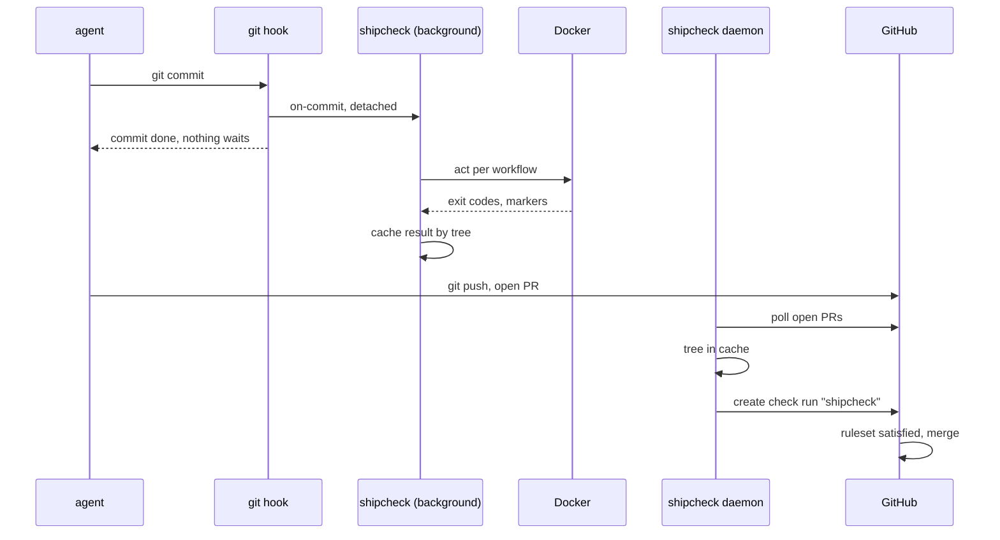

# shipcheck architecture

The parts of shipcheck and how they talk. [DESIGN.md](DESIGN.md) says why. [PROOF.md](PROOF.md) says when a check passes. User docs are in `site/content/docs`.

## Components

| Component | Runs as | Does |
|---|---|---|
| `shipcheck` | the developer, an agent or a hook | One binary. Runs workflows with `act` in copy-on-write checkouts, caches results by tree, posts checks, and runs the daemon |
| Git hooks | git, in each clone | `pre-push` and `post-commit`, written by `shipcheck install`. They start background runs and never block git |
| `shipcheck daemon` | the developer's user, started once through `passbox exec` | Polls GitHub for open PR heads and posts the `shipcheck` check from cached results |
| Docker engine | the developer's user | Docker Desktop, OrbStack or colima |
| shipcheck.run GitHub App | GitHub | Checks write, Contents read, Metadata read, Pull requests read, Merge queues read. No webhook. One App, ours. Its key lives in the hosted service, and on the author's machines for the daemon |
| Hosted service | Cloudflare Worker at `api.shipcheck.run` | Signs machines in and posts the `shipcheck` check for `shipcheck post` on machines without an App key |
| Ruleset on `main` | GitHub | Requires the `shipcheck` check from the App, and up-to-date branches |
| Workflows | GitHub Actions | Unchanged. They run on `push` to `main` as before, which is the backstop |

## Flows

**A run.** `shipcheck run`, or a background run started by a hook:

1. Fetches `origin/main`, unless `--no-fetch`, and reads `shipcheck.toml` and `.github/workflows/` there.
2. If `paths` is set and no changed file matches, answers with a pass that ran nothing (PROOF.md).
3. Computes the cache key (PROOF.md). A cached pass answers at once. A cached failure runs again.
4. Takes the per-tree lock, so a second request for the same tree waits and reads the result, then a machine-wide run slot.
5. Takes a slot, `runs/<owner>/<repo>/<n>`, and runs every workflow in `workflows` at the same time, as GitHub does. In each, it starts every job whose `needs` have passed, and all jobs of the run together stay within `max_parallel`. A job whose need failed does not run, one whose need was skipped is skipped.
6. Each job gets its own checkout, made with `git_cow::add_with` from its own template at a fixed path, `runs/<owner>/<repo>/<n>/<file>/<job>`. shipcheck writes the workflow files from step 1 into it unchanged, writes the prepared copy with the injected steps beside it, and deletes `.actrc`, `.env`, `.secrets`, `.vars` and `.input`. `ubuntu-latest`, `ubuntu-24.04` and `ubuntu-22.04` get catthehacker images pinned by digest unless `[act] platforms` maps them, so act never asks for a default image.
7. Runs `act -j <job>` in it, with `retries`, reads the markers and the job's outputs from its log, then warms the job's template with `git_cow::warm` and removes the checkout.
8. Writes the cache entry and the logs, one per job and one per workflow.

**Background runs.** The hooks call `shipcheck on-commit` and `shipcheck on-push <ref> <sha>`. Each one checks `on`, then starts `shipcheck run --no-fetch --sha <sha>` detached, in its own process group, with git's hook variables (`GIT_DIR`, `GIT_INDEX_FILE` and others) removed, and returns. One background run per repository and branch is recorded in `background/<owner>/<repo>/<branch>.pid` as `<process group> <sha>`. A newer commit sends `SIGTERM` to the older group first. A request for the commit already running leaves it alone. Output goes to `logs/background.log`.

**The daemon.** Every `interval_seconds`, per repository in `daemon.toml`:

1. Lists open PRs into the configured branch. PRs into other branches are skipped, since `shipcheck.toml` on `main` says nothing about them.
2. For each head without a completed `shipcheck` check from our App: fetches the commit if needed (`pull/<n>/head`) and looks up its result.
3. On a result, posts it. On none, runs it if `run_misses = true` and the PR is not from a fork, and otherwise waits for a local run. A fork's code never runs on our machine.
4. While it waits, the check shows `in_progress` if a run of that tree holds its lock on this machine, and `queued` if none does. The result completes the same check run.



## State

Under `~/Library/Application Support/shipcheck` on macOS and `$XDG_STATE_HOME/shipcheck` on Linux, or `SHIPCHECK_HOME`.

| Path | Holds |
|---|---|
| `app.pem` | The App's private key, mode `0600`. Or `SHIPCHECK_APP_KEY_FILE`. The App ID comes from `SHIPCHECK_APP_ID`, injected by passbox |
| `token` | The hosted service's machine token from `shipcheck login`, mode `0600`. `SHIPCHECK_TOKEN` overrides it, `SHIPCHECK_API` changes the service URL |
| `daemon.toml` | `interval_seconds` (10), `run_misses` (false), and `[repos]` as `"owner/repo" = { path = "<clone>", base = "origin/main" }` |
| `secrets/<owner>/<repo>.env` | Secrets passed to `act` with `--secret-file`. Never from the commit |
| `templates/<owner>/<repo>/<file>/<job>/` | One git-cow warm template per job, fed only by shipcheck's runs |
| `runs/<owner>/<repo>/<n>/<file>/<job>/` | Job checkouts at fixed paths per slot and job, `<n>.lock` held during a run |
| `actcache/<owner>/<repo>/` | act's `actions/cache` server, one per repository instead of act's machine-wide `~/.cache/actcache` |
| `runs/<owner>/<repo>/<n>.artifacts/<file>/` | The artifact directory of one workflow run, shared by its jobs |
| `cache/<key>.json` | One result per cache key |
| `locks/<key>.lock` | Held while a tree runs |
| `runners/<n>.lock` | Machine-wide run slots, `SHIPCHECK_MAX_RUNS` of them, a quarter of the CPUs by default |
| `background/<owner>/<repo>/<branch>.pid` | The background run of each branch, for cancel-in-progress |
| `logs/<key>/<workflow>.log` | Full workflow logs. `logs/background.log` for background runs |

`owner/repo` comes from the `origin` URL, with `.` and `..` refused, so no state path leaves the state directory.

Rejected: a daemon with a socket that every run goes through. The per-tree lock and the run slots give the same queueing and sharing between processes, so the daemon only does what needs the App.

## Repository config: `shipcheck.toml`

Written by the repository owner, read from `origin/main` only. The settings follow a workflow's inputs: `workflows`, `on`, `paths`, `timeout_minutes`, `retries`, `max_parallel`, and `[act]` for `platforms` and `cache_paths`. The reference is `site/content/docs/config.md`.

The unit is the workflow file. Every job in a listed workflow runs, so a job added later is covered without a config change. Rejected: one entry per job, because `act -j <job>` also runs the jobs in its `needs`, so shared jobs ran once per dependent. Rejected: a second list, `main_only`, that every workflow must appear in. It made the owner keep two lists.

`paths` lists changed files with `git -c core.quotePath=false diff --no-renames --name-only -z <base>...<sha>`, so a quoted name or the old side of a rename cannot slip past the filter. A name that is not UTF-8 means run.

`shipcheck init` writes the file with every workflow listed. The owner removes deploys and anything else that must not run on a laptop.

## act invocation

```
cd <job checkout> && act workflow_dispatch \
  -W .github/workflows/<file> -j <job> \
  -P <platform>=<image@digest> \
  --bind --pull=false --rm \
  --container-options "-v shipcheck-<home hash>-<owner>-<repo>-<hash>-<path>:<path> ..." \
  --secret-file <secrets file or /dev/null> \
  -s GITHUB_TOKEN= --container-daemon-socket - --no-cache-server \
  --env-file /dev/null --var-file /dev/null --input-file /dev/null
```

| Flag | Why |
|---|---|
| `-j <job>` | One act process per job, so each job has its own checkout as on GitHub. act would also run the job's `needs`, so the job's copy drops `needs`, and `needs.<job>.outputs.<name>` and `needs.<job>.result` become literals. Any other use of `needs`, such as `toJSON(needs)`, fails the job. A last injected step prints the job's `outputs`, hex-encoded, for the jobs that need it. The workflow `name` gets a tag of the checkout's path, since act names containers after workflow and job and removes an older container of that name |
| `--bind` | Mounts the job checkout instead of copying it, which keeps the copy-on-write gain |
| `--pull=false` | Pinned images never need a registry check |
| `--rm` | Without it, act leaves the container of a failed job running |
| `--container-options -v` | A Docker volume per repository for each of `cache_paths`, so package caches survive between runs. Only caches that lock themselves: parallel jobs share the volumes, and two rustup installs into one shared `~/.rustup` broke each other in the oblivion trial, and so did cargo, whose lock sits at the root of `~/.cargo` outside the shared directories. act keeps `/opt/hostedtoolcache` in its own volume |
| `--network none` | The default, `network = "none"`. act's own default is the host's network, which reaches every service on the machine and the LAN. `network = "internet"` drops the flag, see SECURITY.md |
| `--container-daemon-socket -` | act mounts the host's Docker socket into every job by default, and a job with the socket owns the host: every file, the App key, the secrets, the cache. Jobs that build images or start containers need an opt-in, not built yet |
| `--no-cache-server` | act's `actions/cache` server listens on the LAN address with no authentication, and every branch shares it, so a stranger on the network or an earlier commit could plant what a later run restores. The warm checkout per job replaces it, and `actions/cache` steps miss. Its old directory, `actcache/<owner>/<repo>`, is still removed by `shipcheck clean` |
| `-s GITHUB_TOKEN=` and a cleared environment | act fills an unset `GITHUB_TOKEN` secret from the host's token, and would pass a host `GITHUB_TOKEN` to jobs. act gets only `PATH`, `HOME`, `USER`, `TMPDIR`, locale, `XDG_CACHE_HOME` and `DOCKER_*` |
| `/dev/null` files | act would otherwise read `.env`, `.secrets`, `.vars` and `.input` from the commit |
| `--artifact-server-path`, `--artifact-server-port` | Jobs pass build output through `upload-artifact`. A directory per workflow run that every job's act process shares, emptied for each run, and a free port per act process, since act's fixed default port would let concurrent runs share a server. Open: act listens on the machine's network address, so artifacts are reachable on the LAN during a run. Binding to `127.0.0.1` would cut off containers on Docker Desktop, whose network is a VM, so this needs a test of what containers can reach |

`act --version` runs from `/`, so a repository's `.actrc` cannot change the version that goes into the key.

A job checkout sits at a fixed path per repository, slot and job, because builds embed absolute paths, such as cargo's `CARGO_BIN_EXE_*`. Rejected: a new path per run, which failed git-cow's own CLI tests on every warm run. The template is fed only by shipcheck's runs, since host builds from the developer's checkout break in a Linux container.

Rejected for now: `act --reuse`, which keeps containers between runs. A run would start from the previous run's files and packages, so a result could depend on the previous commit. It may come back as an opt-in setting if the oblivion trial shows container setup is a large share of a run.

## Injected steps

Before a run, shipcheck edits its copy of each workflow, never the repository's. It adds `workflow_dispatch:` to the triggers, so `act workflow_dispatch` runs a workflow that on GitHub runs only on `push` to `main`. Each job with `steps:` gets a first and a last step:

```yaml
- name: shipcheck start
  run: echo "shipcheck-start <nonce> ${{ github.job }}"
# ... the job's own steps ...
- name: shipcheck end
  if: always()
  run: echo "shipcheck-end <nonce> ${{ github.job }} ${{ job.status }}"
```

The nonce is new for each run, so test output cannot be mistaken for a marker. A job that started with no end marker was killed. A job with no markers was skipped by its own `if:`. A job act skipped as an unsupported platform fails the workflow. A job with `continue-on-error: true` that fails, is killed or times out does not fail the workflow, as on GitHub, and the jobs that need it still run. Jobs that call a reusable workflow have no steps and get no markers.

Before `shipcheck start`, the act runner adds one more step: it checks that `.git/shipcheck-nonce` in the job's workspace holds the value written for this job a moment before. OrbStack has shown a job the files the previous run left at the same path, and colima shows an empty directory for a path outside the home directory. Both fail this step, and act exits non-zero, so the job fails instead of passing on a tree it never tested.

The edit uses `yaml-rust2`, a YAML 1.2 parser, where `on` stays a string. Rejected: inserting text into the YAML, which breaks on flow style and anchors. Rejected: parsing act's own log format for job results, which ties shipcheck to one runner.

## Matrix jobs

act 0.2.89 evaluates `runs-on: ${{ matrix.os }}` at random across the legs of a matrix. So shipcheck expands every static matrix itself, by GitHub's rules: the product of the axes, minus `exclude`, then `include` entries that extend the combinations they do not overwrite or become new ones. Each leg becomes a job `<id>__<n>` with a one-entry matrix and a literal `runs-on` and `continue-on-error`, and `needs:` on the original job is rewritten to all its legs. A matrix built from an expression is left to act.

`needs.<id>.outputs` of a matrix job resolve under its old id to the outputs of its legs, the last leg winning, as on GitHub.

## Where jobs run

Linux jobs run in Linux containers. shipcheck never runs a job on the host, so `-self-hosted` platforms are refused and macOS and Windows jobs stay on GitHub. When act skips a job as an unsupported platform, the workflow fails with `no image for its runs-on label on this host`, which also covers a Linux label with no image in `[act] platforms`.

The checkout keeps the base's workflow files unchanged, only the top-level `.yml` and `.yaml` files replaced, so a job that runs `git diff` sees no change and the scripts and data next to them stay. The prepared workflow that act runs sits beside the checkout, `<job>.workflows/<file>`, passed with `-W`. The job's repository has a branch `shipcheck` at the tested commit, so `github.ref` is `refs/heads/shipcheck`. Each job gets its own `RUNNER_TOOL_CACHE` through `job_homes`, since act's one tool cache for every job gave parallel setup actions half-copied installs. `git worktree` changes for a repository hold one lock file, across processes, so a prune never deletes another job's half-made worktree.

A workflow that mixes macOS host jobs and Linux container jobs shares one run directory between them. Tart VMs for macOS jobs would separate them.

## Check run

One check run named `shipcheck` on the commit, posted with an installation token of the App. The summary holds the manifest from PROOF.md as a table. Log tails of failed jobs go into the check only with `logs = "failed"` in `shipcheck.toml` on main, or `shipcheck post --with-logs`, since a log can hold paths, names or secrets act did not mask, and a check on a public repository is public.

When the commit changes `.github/workflows/` or `shipcheck.toml` since its merge base with the base, the title ends in ", changes CI" and the summary lists each changed file, and each job or step a change lets fail (`continue-on-error`) or never runs (`if: false`), and each job or step it removes. The base's versions are what ran, so this never changes the conclusion. It tells the reviewer what the PR does to CI for everyone once merged. Rejected: comparing with the base itself, which blames a branch that is behind for the base's newer edits.

## Hosted service

A Cloudflare Worker with one D1 table, `tokens`: the SHA-256 of each machine token, the GitHub user id and login, the machine name, the time it was made and the time it expires, 90 days after its last use. It stores nothing else.

| Endpoint | Auth | Does |
|---|---|---|
| `GET /v1/login` | none | Returns the App's public client id, for the device flow |
| `POST /v1/login` | `{token, machine}` with a GitHub user token | Asks GitHub, with the App's client secret (`POST /applications/{client_id}/token`), whether our App issued the token and to whom. A PAT or another App's token is refused. Drops the token, stores a new machine token's hash and returns `{token, login, expires}` |
| `DELETE /v1/login` | machine token | Deletes that token |
| `POST /v1/checks` | machine token | `{repo, sha, check, check_id?}`: posts the check, returns `{id, html_url}` |

`POST /v1/checks` in order:

1. Finds the machine token, refused with 401 if unknown or expired. An expired row is deleted.
2. Accepts only a body that `src/check.rs` builds: `name` is `shipcheck`, `head_sha` equals `sha` (40 hex), only the fields check.rs writes, each output field within GitHub's 65,535 characters, the request within 512 KiB. Anything else is a 400, before any GitHub call.
3. Signs an App JWT (RS256, WebCrypto) and finds the App's installation on `repo`, a 404 if there is none.
4. Mints an installation token for that one repository with `checks: write` and `metadata: read`.
5. Reads the user's permission on `repo` with that token. Only `admin` and `write` pass, and GitHub reports maintain as `write`. The user id must match the stored one, since a renamed login can pass to someone else.
6. Creates the check run. With `check_id`, it updates that run instead, only if it is this App's `shipcheck` run on the same commit. A post that passed step 5 gives the token 90 more days, written at most once a day.

Every error is JSON, `{error}`, with a status code: 400 and 413 for the body, 401 for the token, 403 for the permission, 404 for the App, 502 when GitHub refuses, 500 for anything else.

Dependencies, all for development: `wrangler`, `@cloudflare/workers-types`, `typescript`, `@types/bun`. The Worker itself imports nothing.

## Team setup

| Part | Installed | Does |
|---|---|---|
| The GitHub App and the ruleset | Once per repository, by the owner | The gate. Every PR needs the `shipcheck` check to merge |
| `shipcheck.toml` | Committed by `shipcheck init` | What must pass, and when runs start |
| The hooks | Once per clone, by `shipcheck install` | Start background runs on commit and push, so the result is cached before the PR exists. Git never installs hooks on clone, so each clone needs this one step |

The hooks live in `.git/hooks`, written from the binary. Rejected: a committed `.githooks/` with `core.hooksPath`, the husky pattern, because any branch checked out could change the code that runs on the next push. When another hook manager owns the hooks, `install` leaves them alone and prints the line to add.

An agent that skips the hooks with `--no-verify` still cannot merge: the check comes only from results shipcheck produced.

## CLI

| Command | Does |
|---|---|
| `shipcheck run [--sha <rev>] [--no-fetch] [--base <ref>]` | Runs in the foreground and waits. Exit 0 pass, 1 fail, 2 error |
| `shipcheck status [<rev>]` | The stored result. Exit 2 if none |
| `shipcheck logs [<rev>]` | The full workflow logs |
| `shipcheck post [<rev>] [--with-logs]` | Posts the stored result as the check, with the App key on this machine if there is one, otherwise through the hosted service with the machine token |
| `shipcheck login`, `shipcheck logout` | Sign this machine in to the hosted service with GitHub's device flow, keeping the machine token in `token`, or revoke it |
| `shipcheck daemon` | The poll loop |
| `shipcheck init`, `shipcheck install` | Set up a repository and a clone |
| `shipcheck on-commit`, `shipcheck on-push <ref> <sha>` | Called by the hooks |

## Crate layout

One crate, one binary. Rejected: a separate daemon binary, one more thing to install for one subcommand.

| Path | Holds |
|---|---|
| `src/bin/shipcheck.rs` | CLI, hooks entry points, background runs |
| `src/config.rs` | `shipcheck.toml` |
| `src/cache.rs` | Cache key |
| `src/workflow.rs` | Start and end markers, reading them from the log |
| `src/run.rs` | Plan, run directory, results, `paths` |
| `src/runner/mod.rs` | The `Runner` trait |
| `src/runner/act.rs` | The act runner: `workflow_dispatch`, matrix expansion, per-job labels and tool homes, the act command, Docker volumes and orphan containers |
| `src/check.rs` | Check run body |
| `src/github.rs` | App JWT, installation token, open PRs, check runs |
| `src/service.rs` | `login`, `logout`, and posting through the hosted service |
| `src/daemon.rs` | `daemon.toml` and the poll loop |
| `src/setup.rs` | `init`, `install` and the hook scripts |

Dependencies: `serde`, `serde_json`, `toml`, `yaml-rust2`, `sha2`, `globset`, `git-cow`, `ureq` and `jsonwebtoken`. Rejected: `octocrab` and `tokio`, since one blocking HTTP call per check needs no async runtime.

## Build order

1. Done: local runs, the cache, injection, matrix expansion, fixed run paths, cache volumes, locks and slots.
2. Done: posting the check as the App. First check posted on 2026-10-20.
3. Done: the daemon, background hooks with cancel-in-progress, and `shipcheck.toml` shaped like workflow inputs.
4. Next: the oblivion trial, a large repository with many workflows.
5. Built, not deployed: the hosted service. Then the merge queue in the daemon.
